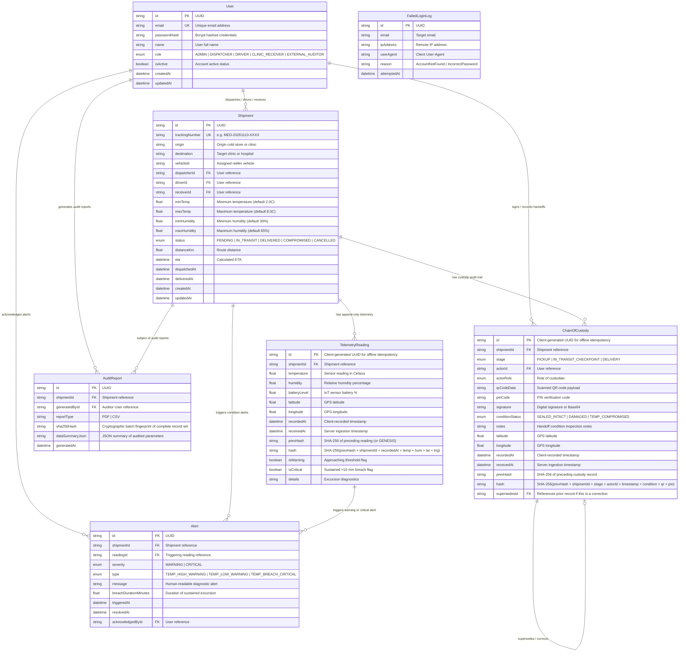

# ColdChain Pulse – Final Database Schema (ERD) & Data Integrity Architecture

**Client:** MedSwift Logistics Ltd.  
**Department:** Backend & Data Engineering  
**Version:** 1.0.0 (Production Candidate)

---

## 1. Entity-Relationship Diagram (ERD)

---

## 2. Data Integrity Architecture & Cryptographic Hash Chaining

The backend enforces two layers of data integrity:

### Layer 1: Cryptographic Hash Chaining (Blockchain-like Ledger)
- Every `TelemetryReading` calculates:
  $$\text{hash}_n = \text{SHA-256}(\text{prevHash} \parallel \text{shipmentId} \parallel \text{recordedAt} \parallel \text{temperature} \parallel \text{humidity} \parallel \text{lat} \parallel \text{lng})$$
  where $\text{prevHash}_0 = \text{"GENESIS"}$ and $\text{prevHash}_n = \text{hash}_{n-1}$.
- Every `ChainOfCustody` record calculates:
  $$\text{hash}_n = \text{SHA-256}(\text{prevHash} \parallel \text{shipmentId} \parallel \text{stage} \parallel \text{actorId} \parallel \text{recordedAt} \parallel \text{conditionStatus} \parallel \text{qrCodeData} \parallel \text{pinCode} \parallel \text{supersedesId})$$
- The audit endpoint (`/api/v1/audit/shipments/:id/verify-ledger`) recomputes the hash chain from genesis to head. If any value in the database has been modified, deleted, or inserted out of order, the verification halts and flags `isTampered: true` with the exact record ID.

### Layer 2: Append-Only Database Triggers (PostgreSQL)
In accordance with MedSwift Logistics specification:
- `telemetry_readings` and `chain_of_custody` are strictly append-only.
- The PostgreSQL triggers in `prisma/triggers.sql` abort any `UPDATE` or `DELETE` attempt at the database engine level with a `TAMPER_ALERT` exception.
- Corrections are made by adding a new record that references `supersedesId`.
